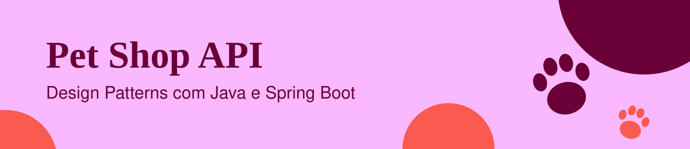
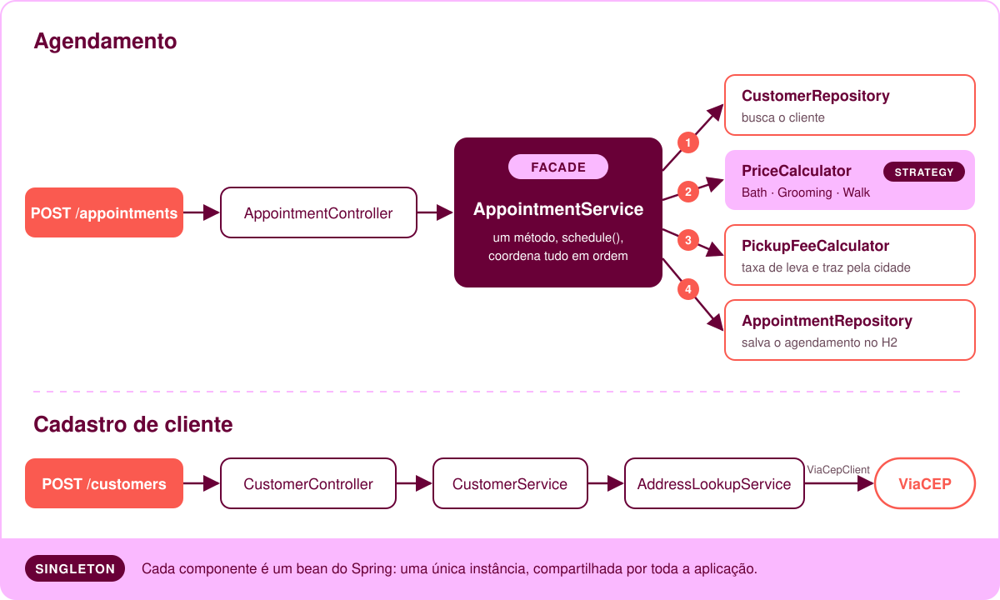

<p align="center">
  
</p>

# petshop-api

API REST de agendamento para pet shop, feita para o desafio de Design Patterns do bootcamp CI&T · Java AI Copilot.

<p align="center">
  
  
  
  
</p>

<p align="center">
  
</p>

## Índice

- [O problema](#o-problema)
- [Como funciona](#como-funciona)
- [Padrões de projeto](#padrões-de-projeto)
- [Decisões técnicas](#decisões-técnicas)
- [Regras de preço](#regras-de-preço)
- [Endpoints](#endpoints)
- [Como rodar](#como-rodar)
- [Testes](#testes)
- [Estrutura](#estrutura)
- [Próximos passos](#próximos-passos)

<p align="center">
  
</p>

## O problema

Em pet shop pequeno, o preço do banho e da tosa costuma ser calculado na hora, de cabeça, e a taxa de leva e traz depende de onde o cliente mora. É fácil cobrar errado.

A API resolve isso em dois passos:

- **Cadastro do cliente:** basta o CEP. O endereço vem do [ViaCEP](https://viacep.com.br).
- **Agendamento:** o preço sai do tipo de serviço e do porte do pet, e a API decide se o leva e traz atende o endereço do cliente.

O desafio permite repetir o exemplo da aula (cadastro de clientes com CEP). Aqui os mesmos padrões foram aplicados a um problema com regra de negócio de verdade.

<p align="center">
  
</p>

## Como funciona

<p align="center">
  
</p>

<p align="center">
  
</p>

## Padrões de projeto

<table>
  <tr>
    <td align="center" valign="middle"></td>
    <td valign="middle">
      <b>Onde:</b> pacote <code>pricing</code>. A interface <code>PricingStrategy</code> tem uma implementação por serviço (<code>BathPricingStrategy</code>, <code>GroomingPricingStrategy</code> e <code>WalkPricingStrategy</code>), e o <code>PriceCalculator</code> escolhe qual usar.<br><br>
      <b>Por quê:</b> cada serviço tem uma regra de preço diferente. Um serviço novo, como hidratação, entra como uma classe nova, sem <code>if/else</code> e sem mexer nas regras que já funcionam.<br><br>
      O Spring injeta todas as estratégias numa lista, e o <code>PriceCalculator</code> monta um mapa por tipo de serviço. Se faltar estratégia para algum serviço, ou se houver duas para o mesmo, a aplicação não sobe: o erro aparece na inicialização, e não no meio de um agendamento.
    </td>
  </tr>
  <tr>
    <td align="center" valign="middle"></td>
    <td valign="middle">
      <b>Onde:</b> <code>AppointmentService.schedule()</code>.<br><br>
      <b>Por quê:</b> agendar envolve quatro componentes: buscar o cliente, calcular o preço, calcular a taxa de leva e traz e salvar. O controller faz uma única chamada, e a fachada coordena o resto na ordem certa. No cadastro, o <code>AddressLookupService</code> faz o mesmo papel com o ViaCEP: o resto do sistema não sabe que existe uma API externa.
    </td>
  </tr>
  <tr>
    <td align="center" valign="middle"></td>
    <td valign="middle">
      <b>Onde:</b> todos os <code>@Service</code>, <code>@Component</code> e repositórios.<br><br>
      <b>Por quê:</b> o Spring cria uma única instância de cada um e reaproveita em toda a aplicação. Por isso nenhuma estratégia guarda estado: a mesma instância atende várias requisições ao mesmo tempo, com segurança.
    </td>
  </tr>
</table>

<p align="center">
  
</p>

## Decisões técnicas

- **Cliente HTTP declarativo do Spring no lugar do OpenFeign.** O `ViaCepClient` é uma interface com `@HttpExchange`, recurso nativo do Spring Framework 7. O Spring Cloud OpenFeign é tratado como completo pelo próprio time do Spring (só recebe correções), e a recomendação oficial é migrar para esse cliente.
- **Preço gravado no agendamento.** Valor do serviço, taxa e total ficam salvos no momento do agendamento. Se a tabela de preços mudar, os agendamentos antigos continuam com o valor combinado.
- **ViaCEP fora da transação.** O cadastro de cliente não abre transação no banco enquanto espera a resposta externa, então nenhuma conexão fica presa por causa de uma API lenta.
- **Falha externa tratada.** A consulta ao ViaCEP tem tempo limite (2 s para conectar e 3 s para ler). Se o serviço cair, a API responde `502` com uma mensagem clara, em vez de um erro genérico.
- **Erros no formato padrão.** Todas as respostas de erro seguem o Problem Details (RFC 9457). Nos erros de validação, a resposta lista cada campo inválido.
- **Sem consultas extras ao banco.** O `open-in-view` está desligado e o cliente é carregado junto com o agendamento (`@EntityGraph`), sem consultas escondidas fora da camada de serviço.
- **Dinheiro com `BigDecimal`.** Nada de `double` em valor monetário.

<p align="center">
  
</p>

## Regras de preço

| Serviço | Pequeno | Médio | Grande | Regra |
|---|---|---|---|---|
| Banho (`BATH`) | R$ 50,00 | R$ 70,00 | R$ 90,00 | Valor fixo por porte |
| Tosa (`GROOMING`) | R$ 80,00 | R$ 100,00 | R$ 120,00 | R$ 80,00 + 25% (médio) ou 50% (grande) |
| Passeio (`WALK`) | R$ 35,00 | R$ 35,00 | R$ 35,00 | Preço único |

O leva e traz custa R$ 15,00 e atende só clientes de Araras/SP. Cidade, estado e taxa ficam no `application.properties`.

<p align="center">
  
</p>

## Endpoints

| Método | Rota | O que faz |
|---|---|---|
| `POST` | `/customers` | Cadastra um cliente e busca o endereço pelo CEP |
| `GET` | `/customers` | Lista os clientes |
| `GET` | `/customers/{id}` | Busca um cliente |
| `POST` | `/appointments` | Agenda um serviço e calcula o preço |
| `GET` | `/appointments` | Lista os agendamentos |
| `GET` | `/appointments/{id}` | Busca um agendamento |

<p align="center">
  
</p>

## Como rodar

Precisa só do JDK 21 ou mais novo. O Maven não precisa estar instalado: o Maven Wrapper (`mvnw`) baixa a versão certa na primeira execução.

 **Clone o repositório e entre na pasta**

```bash
git clone https://github.com/Paula-Thamyres/petshop-api.git
cd petshop-api
```

 **Suba a aplicação**

```bash
./mvnw spring-boot:run
```

No Windows (PowerShell), use `.\mvnw.cmd spring-boot:run`.

 **Abra o Swagger no navegador**

```
http://localhost:8080/swagger-ui.html
```

> [!NOTE]
> O banco é o H2 em memória: os dados somem quando a aplicação para. Os exemplos do Swagger já vêm preenchidos, então dá para testar cadastrando um cliente e, depois, agendando com o `id` que voltou.

### Exemplo

Cadastro de cliente (`POST /customers`):

```json
{
  "name": "Maria Souza",
  "phone": "19999990000",
  "cep": "13600-061"
}
```

Agendamento de banho com leva e traz (`POST /appointments`):

```json
{
  "customerId": 1,
  "petName": "Thor",
  "petSize": "MEDIUM",
  "serviceType": "BATH",
  "scheduledAt": "2030-01-15T10:00:00",
  "pickupAndDelivery": true
}
```

Resposta:

```json
{
  "id": 1,
  "customerId": 1,
  "customerName": "Maria Souza",
  "petName": "Thor",
  "petSize": "MEDIUM",
  "serviceType": "BATH",
  "scheduledAt": "2030-01-15T10:00:00",
  "pickupAndDelivery": true,
  "servicePrice": 70.00,
  "pickupFee": 15.00,
  "totalPrice": 85.00
}
```

<p align="center">
  
</p>

## Testes

```bash
./mvnw test
```

No Windows (PowerShell), use `.\mvnw.cmd test`. Os testes também rodam no GitHub Actions a cada push.

| O que é testado | Como |
|---|---|
| Preço de cada serviço para cada porte | Testes parametrizados das três estratégias |
| Inicialização sem estratégia ou com estratégia duplicada | `PriceCalculatorTest` |
| CEP com hífen, CEP inexistente e ViaCEP fora do ar | `AddressLookupServiceTest`, com o cliente HTTP simulado |
| Taxa de leva e traz dentro e fora da cidade | `PickupFeeCalculatorTest` |
| Fachada de agendamento e casos de erro | `AppointmentServiceTest`, com Mockito |
| Fluxo completo pela API: `201`, `400`, `404` e `502` | `PetshopApiIntegrationTest`, com MockMvc e H2 |
| Códigos documentados no Swagger iguais aos que a API devolve | `PetshopApiIntegrationTest`, lendo o `/v3/api-docs` |

<p align="center">
  
</p>

## Estrutura

```
src/main/java/com/paulathamyres/petshop
├── address/       consulta ao ViaCEP (HTTP Interface) e endereço do cliente
├── appointment/   agendamento (Facade) e taxa de leva e traz
├── config/        configurações do pet shop e do Swagger
├── customer/      cadastro de clientes
├── pricing/       regras de preço (Strategy)
└── shared/        exceções e tratamento global de erros
```

Cada pasta reúne tudo de um assunto: entidade, repositório, serviço, controller e DTOs.

**Tecnologias:** Java 21, Spring Boot 4.1 (Web MVC, Data JPA, Validation e RestClient), H2, springdoc-openapi (Swagger UI), JUnit, Mockito, AssertJ e GitHub Actions.

Desenvolvido com apoio de IA generativa (Claude), como propõe o bootcamp.

<p align="center">
  
</p>

## Próximos passos

- [ ] Cancelar um agendamento, mantendo o histórico
- [ ] Remarcar um agendamento para outra data
- [ ] Recusar dois agendamentos no mesmo horário
- [ ] Recusar cliente com telefone já cadastrado

<p align="center">
  
</p>
